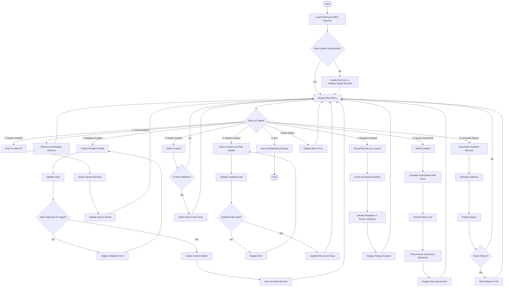

# MASHUJAA ROAD SAFETY MANAGEMENT SYSTEM
## OVERVIEW
MASHUJAA Is a python-based road safety management syste for recording accidents,assessing risk and identifying accident hotspots.
## PROBLEM STATEMENT
Road accidents are one of the major factors for loss of life,injuries and damage of property in Kenya.Having a management system that is able to organise and clean road accident data reports is useful for identifying recurring risk factors for analysis and clear decision making process.
MASHUJAA aims to provide a simple system for managing accident records and produce rule-based summaries that can support decision making processes.
## OBJECTIVES
- Record and manage road accident information.
- Validate incident data before storing it.
- Calculate and classify incident risk using predefined rules.
- Map out locations with recurring accidents
- Generate reports on total accidents,injuries,severities and risk categories.
## FEATURES
1. Accident registration and record management.
2. Input validation and Error Handling.
3. Rule-based risk assessement.
4. Accident hotspot analysis.
5. CSV data persistence.
6. Report Generation.
7. Menu-driven interface.
## TECHNOLGIES USED
- Python: Application development.
- CSV: data storage and exchange.
- Python standard libraries: File handling,date preprocessing,data analysis
## PROJECT STRUCTURE

MASHUJAA/
│
├── main.py
├── README.md
├── requirements.md
│
├── models/
│   ├── __init__.py
│   ├── incident.py
│   └── road.py
│
├── services/
│   ├── __init__.py
│   ├── incident_service.py
│   ├── risk_assessment.py
│   └── hotspot_analysis.py
│
├── storage/
│   ├── __init__.py
│   └── file_manager.py
│
├── validation/
│   ├── __init__.py
│   └── validators.py
│
├── data/
│   └── incidents.csv
│
├── reports/
│   └── .gitkeep
│
└── tests/
    ├── __init__.py
    ├── test_incident.py
    ├── test_risk_assessment.py
    ├── test_validation.py
    └── test_storage.py
## SYSTEM FLOWCHART

## PREREQUISITES
- Python 3.10 or other version
- Visual studio code or Pycharm
- Command prompt
## INSTALLATION AND USAGE
1. Obtain the project files.
2. Open the project folder in your preffered code editor.
3. Check it's the required version.
4. Use main.py to run the program.
## TESTING
The program should be tested with valid and invalid inputs,duplicate incident identifiers,missing data files and application restarts to verify data.
## LIMITATIONS
1. The initial version uses manually entered data and sample data.
2. Risk classifications do not establish an actual probability of a road accident.
3. The risk scores are based on predefined rules not a validated predictive model.
## FUTURE IMPROVEMENTS
1. Integrate  verified accident datasets.
2. Introduce geographical mapping of accident hotspots.
3. Develop a web-based interface.
## LICENSE
Not yet applicable